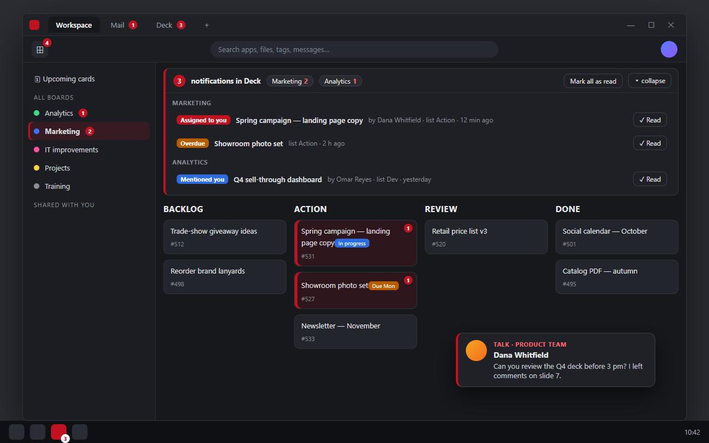

# Nextcloud Desktop Companion

An Electron shell that turns a self-hosted Nextcloud workspace (Files, Talk, Deck, Mail, Calendar, Notes…) into a proper Windows desktop app — with the things a browser tab can't give you: **native notifications, an unread badge on the taskbar icon, a tray presence, multi-tab browsing of the same session, per-tool unread counters and auto-updates from a plain HTTPS folder**.

> Curated excerpt of a production app used daily by a mid-size company. No customer data, no infrastructure details. Names and numbers in the screenshot are fictitious.



## Why a shell and not "just the browser"

| Browser tab | Companion |
|---|---|
| Notifications only while the tab is focused and the OS allows them | Toasts for Talk messages, Deck assignments and mentions — even when the window is hidden in the tray |
| No idea how many things are waiting for you | Unread count on the taskbar icon + per-tool counters (Talk, Deck, Files…) inside the app menu |
| Deck tells you *that* you were assigned, not *where* | Board and card are highlighted; opening the card clears the notification everywhere |
| Ctrl+R reloads one page | Ctrl+R reloads every open view (Mail, extra tabs) at once |
| Logout leaves cookies/sessions of other views behind | "Logout clears everything" — all partitions and views are wiped together |
| Manual installs | Silent updates from a static feed, with a **beta ring** that gets builds first |

## Architecture

```mermaid
flowchart LR
  subgraph Electron main process
    W[BrowserWindow<br/>custom title bar + tabs]
    V1[BrowserView: workspace]
    V2[BrowserView: mail]
    V3[BrowserView: extra tabs]
    T[Tray + taskbar badge]
    U[Auto-updater<br/>beta ring → stable]
    H[IPC hub<br/>toast dedup, counters]
    W --> V1 & V2 & V3
    H --> T
    H --> U
  end
  subgraph Preload (runs inside every view)
    P1[Notification poller<br/>OCS API]
    P2[Deck enhancer<br/>board/card highlights]
    P3[Talk toast hook]
  end
  V1 & V2 & V3 -. contextIsolation .-> P1 & P2 & P3
  P1 & P2 & P3 -- ipcRenderer --> H
  P1 -- fetch --> NC[(Nextcloud<br/>OCS notifications API)]
```

Everything the shell knows comes from Nextcloud's own **OCS notifications API**; the app never touches the database or the server. All DOM enhancements live in the preload, so the web UI stays untouched upstream.

## Three small ideas that made the difference

### 1. The unread count becomes a taskbar overlay

The renderer polls the notifications endpoint, draws the number on a tiny canvas and hands the PNG to the main process. No native modules, works on every Windows version.

```js
// renderer (preload) — paint "3" on a 32×32 red disc and send it over IPC
function overlayFor(count) {
  const c = document.createElement('canvas'); c.width = c.height = 32;
  const ctx = c.getContext('2d');
  ctx.fillStyle = '#c1121f'; ctx.beginPath(); ctx.arc(16, 16, 16, 0, Math.PI * 2); ctx.fill();
  ctx.fillStyle = '#fff'; ctx.font = 'bold 19px sans-serif';
  ctx.textAlign = 'center'; ctx.textBaseline = 'middle';
  ctx.fillText(count > 9 ? '9+' : String(count), 16, 17);
  return c.toDataURL('image/png');
}
ipcRenderer.send('unread', { count, overlay: count ? overlayFor(count) : null });

// main — one place decides what the OS shows
ipcMain.on('unread', (_e, { count, overlay }) => {
  win.setOverlayIcon(overlay ? nativeImage.createFromDataURL(overlay) : null, `${count} unread`);
  app.setBadgeCount(count);
});
```

### 2. One toast per notification, however many views are open

Several views (workspace, mail, extra tabs) poll the same API, so the same notification arrives from each of them. The main process is the single gate: a bounded `Set` of ids keeps the first and drops the rest — and only the view that is *not* already inside that Talk conversation gets to play the sound.

```js
const seen = new Set();
ipcMain.on('notify', (_e, n) => {
  if (n.id != null && seen.has(n.id)) return;            // another view was first
  if (n.id != null) {
    seen.add(n.id);
    if (seen.size > 800) {                                // keep memory bounded
      const keep = [...seen].slice(-400); seen.clear(); keep.forEach((x) => seen.add(x));
    }
  }
  const focusedHere = win.isFocused() && n.isTalk && n.conversation === n.currentConversation;
  if (focusedHere) return;                                // the chat itself is on screen
  showBrandToast(n);                                      // frameless always-on-top window
  if (n.ding) mainView.webContents.send('do-ding');       // sound once, from one view
});
```

### 3. A beta ring on a static feed

`electron-updater` with a *generic* provider only needs an HTTPS folder. Publishing to a `beta.yml` first and promoting to `latest.yml` later gives a two-ring rollout with zero infrastructure: beta testers are simply the machines told to look at the beta file first.

```js
import { autoUpdater } from 'electron-updater';

const FEED = 'https://files.example.com/app-updates';
const ring = store.get('ring', 'stable');                 // 'beta' for the pilot group

async function checkForUpdates() {
  for (const channel of ring === 'beta' ? ['beta', 'latest'] : ['latest']) {
    autoUpdater.setFeedURL({ provider: 'generic', url: FEED, channel });
    try {
      const r = await autoUpdater.checkForUpdates();     // reads <channel>.yml
      if (r?.updateInfo && r.updateInfo.version !== app.getVersion()) return r;
    } catch { /* that channel has no file yet — try the next */ }
  }
  return null;
}
```

Promotion is a file copy on the server (`beta.yml` → `latest.yml`), so a bad build never reaches the stable ring.

## Other things it does

- Single instance, start with Windows, close-to-tray; the window re-opens on the tray icon or on a toast click (deep-linking to the card/conversation).
- Offline page with automatic retry instead of Chromium's error screen.
- Custom title bar with tabs; `Ctrl+K` opens the unified search; `Ctrl+Shift+R` reloads all views ignoring cache.
- Deck: highlighted boards/cards for pending assignments and reminders; opening the card marks the notification as read through the API, so phones and the web UI agree.
- HTML attachments open rendered in a sandboxed tab (data URL origin), not as source.

## Stack

Electron 31 · `electron-updater` (generic provider) · `electron-builder` (NSIS) · plain JavaScript, no framework in the shell.
